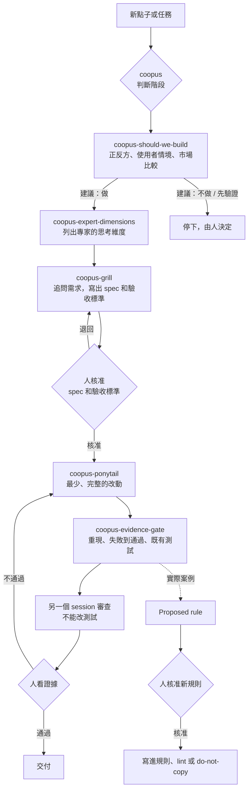

# coopus

## English

**Status: v0.4.** Validated 2026-11-15 with agent_playground on Claude sonnet-5-5 (medium effort): 8 tasks, at least 3 runs each, web off, Codex as judge. v0.4 beat v0.3 (bug-finding without false positives 58 → 92, resisting skip-to-code 49 → 83, no required-item regressions) and beat no-skill on 6 of 8 tasks with none worse. Codex-side runs are not done yet. Evaluation tasks are maintained separately.

coopus is a skills pack for Claude Code and Codex that encodes one working model: decide whether to build before deciding how, list the dimensions a domain expert would check, turn vague requests into a spec with acceptance criteria approved before code, write the smallest complete change without copying known-bad patterns, and back every claim of "bug" or "done" with reproducible evidence. The human approves the spec and acceptance criteria, reviews evidence instead of code, and approves new rules.

- Skills live in `skills/<name>/SKILL.md`. The English `SKILL.md` is authoritative.
- `skills/<name>/SKILL.zh-TW.md` is a Traditional Chinese guide for human reading only. It has no frontmatter, so agents do not load it as a skill.
- Install: copy `skills/*` into `~/.claude/skills/` (Claude Code) or `~/.agents/skills/` (Codex). Details below, in Chinese.
- License: MIT. `coopus-ponytail` is a modified version of ponytail by Dietrich Gebert (MIT).
- Sources: questioning approach from Matt Pocock's [grill-me](https://github.com/mattpocock/skills) (MIT, approach only, no text copied); `coopus-ponytail` forked from [ponytail](https://github.com/DietrichGebert/ponytail) (MIT). Design notes: [docs/DESIGN.md](docs/DESIGN.md).

---

## 中文說明

**狀態：v0.4。** 2026-11-15 以 agent_playground 驗證，模型 Claude sonnet-5-5（medium effort）：8 個任務、每個至少跑 3 次、關閉網路、由 Codex 評分。v0.4 勝過 v0.3（找 bug 且無誤報 58 → 92、抗拒直接跳去寫 code 49 → 83、必要項目沒有退步），並在 8 個任務中有 6 個勝過不用 skill，其餘沒有變差。Codex 端的測試尚未完成。評測任務另外維護。

coopus 是一包給 Claude Code 和 Codex 用的 skills，把我用 AI 做事的方式整理成可以直接呼叫的流程：先判斷該不該做，再用專家維度補足不熟的領域，把模糊需求問成有驗收標準的 spec，用最少的 code 實作，最後用證據證明做對了。

核心想法：

- 人負責需求和方向，AI 負責把需求問清楚、補上人沒想到的地方、寫 code、拿出證據。
- AI 要挑戰使用者，不是順著使用者講。
- 沒有證據的主張不算數，包括「有 bug」「修好了」和「這該變成一條規則」。
- 人不看 code，看證據。人只做三件事：核准 spec 和驗收標準、看證據、核准新規則。

## 流程



## Skills

| Skill | 做什麼 | 什麼時候用 |
|-------|--------|------------|
| `coopus` | 總入口，判斷現在在哪個階段，該叫哪個 skill | 任何新點子或任務的開頭，或不確定要用哪個時 |
| `coopus-should-we-build` | 正反方辯論、目標使用者和情境、市場比較，最後給做或不做的建議，附信心、依賴的假設和翻盤條件 | 新點子、新產品、新功能，還沒確定要做 |
| `coopus-expert-dimensions` | 列出專家會檢查的維度，每個寫出在問什麼、取捨、什麼時候會出事、用什麼數字判斷 | 設計架構、選技術、進入不熟的領域 |
| `coopus-grill` | 只問會改變做法的問題，每題附建議答案，最後產出含驗收標準的 spec | 決定要做，但需求還模糊 |
| `coopus-ponytail` | ponytail 的修改版：最少、完整的改動，而且不照抄 `docs/do-not-copy.md` 上的爛寫法 | 有核准過的 spec，開始寫 code |
| `coopus-evidence-gate` | 沒有重現或失敗的測試不能說有問題，沒有失敗到通過的紀錄不能說完成；新規則要有實際案例並由人核准 | 回報 bug 或漏洞、宣稱完成、code review、想新增規則時 |

關於註解：不寫重述程式碼的註解；不明顯的選擇，用一行寫「為什麼」。這條規則在 `coopus-ponytail` 裡。

## 安裝

每個 skill 是一個資料夾，裡面有一份 `SKILL.md`。Claude Code 和 Codex 讀的是同一種格式，所以同一份檔案兩邊都能用。

每個資料夾還有一份 `SKILL.zh-TW.md`，是給人看的繁中翻譯，沒有 frontmatter，agent 不會把它當成 skill 載入。內容以英文 `SKILL.md` 為準。一起複製過去沒有影響。

### Claude Code

```bash
git clone <this repo> coopus

# 所有專案都能用
mkdir -p ~/.claude/skills
cp -R coopus/skills/* ~/.claude/skills/

# 或只給某個專案用
mkdir -p .claude/skills
cp -R coopus/skills/* .claude/skills/
```

### Codex

```bash
# 所有專案都能用
mkdir -p ~/.agents/skills
cp -R coopus/skills/* ~/.agents/skills/

# 或只給某個專案用（放在 repo 根目錄）
mkdir -p .agents/skills
cp -R coopus/skills/* .agents/skills/
```

舊版 Codex 讀的是 `~/.codex/skills`，新版建議改用 `~/.agents/skills`。

想要 clone 下來的 repo 更新後兩邊自動同步，可以用 symlink 取代 `cp`，例如 `ln -s "$PWD/coopus/skills/coopus" ~/.claude/skills/coopus`。

### AGENTS.md（選用）

skill 是需要時才載入。如果想讓某個專案每次都套用 coopus 的分工，可以在 repo 根目錄的 `AGENTS.md`（Codex）或 `CLAUDE.md`（Claude Code）加上：

```markdown
## Working model
- Use the coopus skill to pick the stage before starting any new task.
- Do not write code before the acceptance criteria in the spec are approved.
- Follow coopus-evidence-gate before claiming a bug, a fix, or done.
- Never edit rules, skills, or docs/do-not-copy.md yourself; propose changes instead.
```

### do-not-copy 清單

把 `templates/do-not-copy.md` 複製到你專案的 `docs/do-not-copy.md`。一開始是空的，在 review 時發現爛寫法再逐條加上，只有人能修改。

## 怎麼確認 skill 有生效

1. 丟一個新點子，回覆應該先有正反方和使用者情境，最後有「建議、信心、依賴的假設、翻盤條件」。
2. 丟一句模糊的需求，回覆應該是編號問題，每題附建議答案，每輪最多三題。
3. 在 `docs/do-not-copy.md` 列一個你知道很爛的檔案，給一個會用到類似功能的任務。AI 應該改用替代寫法。
4. 要 AI 修一個 bug，交付時應該附上同一個測試從失敗變成通過的紀錄。

## 更新紀錄 / Changelog

規則 / Rule：每一次修改都要寫明它解決什麼問題，並且在合併前先用測試任務跑過一次，比對修改前後的 flow 和產出。
Every change states the problem it solves and is tried on a test task before merge, comparing flow and output before and after.

### 2026-11-14

- v0.1：初版。六個 skill（`coopus`、`coopus-should-we-build`、`coopus-expert-dimensions`、`coopus-grill`、`coopus-ponytail`、`coopus-evidence-gate`）、`templates/do-not-copy.md`、授權檔。
  Initial release: six skills, do-not-copy template, licenses.
- v0.2：skill 本體改為英文，`SKILL.md` 為準；每個 skill 新增繁中指引 `SKILL.zh-TW.md`。`coopus-should-we-build` 的步驟改為先寫反方、再寫正方，和「不要做」裡的規則一致。
  解決的問題：英文本體讓 Claude Code 和 Codex 的觸發與遵循更穩定，中文指引方便人閱讀。
  English skill bodies (authoritative) plus zh-TW guides for humans; con-before-pro order made consistent in `coopus-should-we-build`.
- v0.3：統一測試改動規則。`coopus-ponytail` 要求「完成被改動弄壞的測試」，`coopus-evidence-gate` 卻說「寫 code 的一方不能修改測試」，兩者衝突。新規則：可以新增測試；只有已核准的需求改變時才能修改既有測試；絕不刪除、跳過或放寬斷言；需求沒變就修 code 不修測試；不確定就問；每個測試改動都要列出原因。審查方仍然不能修改測試。
  解決的問題：兩個 skill 對同一件事給出相反指令。
  Resolved the conflict between ponytail's "finish the tests your change breaks" and the gate's "writer may not modify tests": add allowed, update only on approved requirement change, never delete/skip/loosen, list every change; reviewer still may not modify tests.

### 2026-11-15

v0.4：調整 `coopus` 的核准與證據規則 / Approval and evidence rules in `coopus`.

- 即使使用者說「不用問」，仍須明確回覆 yes 才算核准：先給預設驗收標準，結尾寫「Reply yes and I'll start」。
  Approval needs an explicit yes even when the user says not to ask: give default acceptance criteria and end with "Reply yes and I'll start".
- 小改動也要附證據：修改前後的輸出加上既有測試；行為修正則附上先失敗後通過的測試。
  Small changes need evidence: before/after output plus existing tests, or a fail-then-pass test for behavior fixes.
- 沒有東西需要核准時，省略核准那一行。
  Drop the approval line when there is nothing to approve.
- 用使用者的語言回覆。
  Reply in the user's language.

## 致謝與授權

- coopus 本身：MIT，見 [LICENSE](LICENSE)。
- `coopus-ponytail` 修改自 [ponytail](https://github.com/DietrichGebert/ponytail)，作者 Dietrich Gebert，MIT 授權。原授權全文在 `skills/coopus-ponytail/LICENSE-ponytail`，改動說明在 `skills/coopus-ponytail/NOTICE.md`。
- `coopus-grill` 的做法參考 Matt Pocock 的 [grill-me](https://github.com/mattpocock/skills)（MIT）：決策樹、每題附建議答案、能查的事實自己查。文字是重新寫的，另外加上「該不該做」的檢查和驗收標準。
- 設計說明（問題、來源、不做的事）：[docs/DESIGN.md](docs/DESIGN.md)。
- 整包「每個 skill 只做一件事」的拆法，參考 poteto 的 pstack。沒有使用 pstack 的文字。
